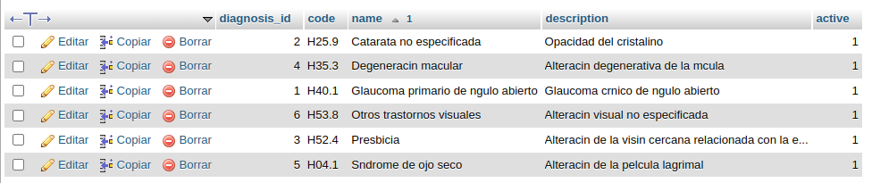
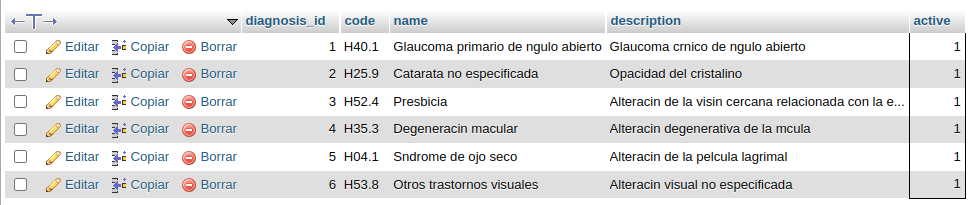
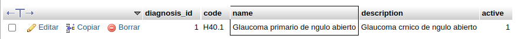
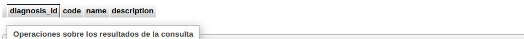
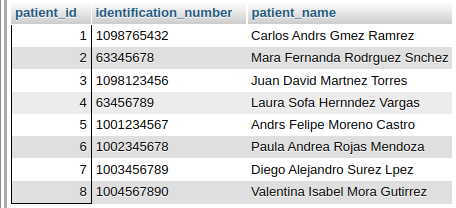
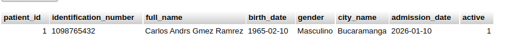

# 	Examen sql2 (Johan sebastian sarmiento chaves)

## Examen 3. Gestión de diagnósticos y antecedentes clínicos

#### 3.1. Planteamiento del problema

 Los profesionales de oftalmología necesitan consultar los diagnósticos registrados durante la atención de los pacientes y relacionarlos con sus antecedentes médicos. 

Un paciente puede presentar múltiples antecedentes, y una consulta puede asociarse con diferentes diagnósticos. 

La institución requiere evitar la duplicación de información, facilitar la consulta de diagnósticos y obtener indicadores relacionados con su frecuencia. 

Se solicita desarrollar consultas SQL y mecanismos de recuperación que permitan organizar y analizar estos datos.

#### 3.3. Actividades evaluativas 

Actividad 1. Normalización — 10 puntos / 10 minutos 

Una estructura no normalizada almacena los siguientes datos:

Explique qué problemas presenta esta estructura y proponga cómo organizar la información en relaciones independientes.

 Indique de qué manera la separación de diagnósticos y antecedentes independientes contribuye a cumplir la Cuarta Forma Normal.

RTA : El problema que se demuestra es que los datos no están bien organizados le hace falta unas tablas intermedias ya que ay relaciones de M a N entonces dificulta ala busqueda u organización de esta base de datos la solucion que yo popongo es crear estas tablas : 

##### Tabla: `patient`

*Descripción: Registro de paciente en el sistema.*

| **Campo**        | **Tipo de Dato** | **Llave** | **Requerido** | **Descripción / Restricción**     |
| ---------------- | ---------------- | --------- | ------------- | --------------------------------- |
| `patient_id`     | BIGINT           | PK        | Sí            | Identificador único de paciente.  |
| `person_id`      | BIGINT           | FK, UK    | Sí            | Referencia a `person(person_id)`. |
| `admission_date` | DATE             | -         | Sí            | Fecha de alta/ingreso al sistema. |
| `active`         | BOOLEAN          | -         | Sí            | Estado del paciente.              |

##### Tabla: `background_type`

*Descripción: Tipos de antecedentes (Patológicos, Quirúrgicos, Familiares).*

| **Campo**            | **Tipo de Dato** | **Llave** | **Requerido** | **Descripción / Restricción**          |
| -------------------- | ---------------- | --------- | ------------- | -------------------------------------- |
| `background_type_id` | BIGINT           | PK        | Sí            | Identificador del tipo de antecedente. |
| `name`               | VARCHAR(100)     | UK        | Sí            | Nombre de la categoría.                |
| `description`        | VARCHAR(250)     | -         | No            | Descripción de la categoría.           |

##### Tabla: `patient_background`

*Descripción: Antecedentes clínicos del paciente (4NF).*

| **Campo**               | **Tipo de Dato** | **Llave** | **Requerido** | **Descripción / Restricción**                       |
| ----------------------- | ---------------- | --------- | ------------- | --------------------------------------------------- |
| `patient_background_id` | BIGINT           | PK        | Sí            | Identificador del registro.                         |
| `patient_id`            | BIGINT           | FK        | Sí            | Referencia a `patient(patient_id)`.                 |
| `background_type_id`    | BIGINT           | FK        | Sí            | Referencia a `background_type(background_type_id)`. |
| `description`           | TEXT             | -         | Sí            | Detalle del antecedente médico.                     |
| `start_date`            | DATE             | -         | No            | Fecha aproximada de diagnóstico.                    |
| `end_date`              | DATE             | -         | No            | Fecha de resolución/fin (si aplica).                |
| `active`                | BOOLEAN          | -         | Sí            | Estado del antecedente.                             |

##### Tabla: `allergy`

*Descripción: Catálogo general de alergias.*

| **Campo**     | **Tipo de Dato** | **Llave** | **Requerido** | **Descripción / Restricción**      |
| ------------- | ---------------- | --------- | ------------- | ---------------------------------- |
| `allergy_id`  | BIGINT           | PK        | Sí            | Identificador único de la alergia. |
| `name`        | VARCHAR(100)     | UK        | Sí            | Nombre de la sustancia/alérgeno.   |
| `description` | VARCHAR(250)     | -         | No            | Descripción o categoría.           |

##### Tabla: `patient_allergy`

*Descripción: Alergias reportadas por paciente (4NF).*

| **Campo**      | **Tipo de Dato** | **Llave** | **Requerido** | **Descripción / Restricción**                |
| -------------- | ---------------- | --------- | ------------- | -------------------------------------------- |
| `patient_id`   | BIGINT           | PK, FK    | Sí            | Referencia a `patient(patient_id)`.          |
| `allergy_id`   | BIGINT           | PK, FK    | Sí            | Referencia a `allergy(allergy_id)`.          |
| `reaction`     | VARCHAR(250)     | -         | No            | Síntomas o manifestaciones clínicas.         |
| `severity`     | VARCHAR(50)      | -         | No            | Grado de severidad (Leve, Moderada, Severa). |
| `observations` | TEXT             | -         | No            | Comentarios adicionales.                     |

##### Tabla: `clinical_history`

*Descripción: Expediente o Historia Clínica electrónica del paciente.*

| **Campo**             | **Tipo de Dato** | **Llave** | **Requerido** | **Descripción / Restricción**                     |
| --------------------- | ---------------- | --------- | ------------- | ------------------------------------------------- |
| `clinical_history_id` | BIGINT           | PK        | Sí            | Identificador de la historia clínica.             |
| `patient_id`          | BIGINT           | FK, UK    | Sí            | Referencia a `patient(patient_id)`.               |
| `history_number`      | VARCHAR(50)      | UK        | Sí            | Código formateado de la historia (ej: HC-000100). |
| `created_at`          | DATETIME         | -         | Sí            | Fecha de apertura del expediente.                 |
| `updated_at`          | DATETIME         | -         | No            | Última actualización del expediente.              |

### Actividad 2. Consultas básicas — 15 puntos / 15 minutos

Escriba tres consultas: 

1. Listar los diagnósticos registrados en el catálogo, mostrando código y nombre. 

   ```sql
   SELECT
       diagnosis_id,
       code,
       name,
       description,
       active
   FROM diagnosis
   ORDER BY name;
   ```

   

2. Mostrar únicamente los diagnósticos activos. 

   ```
   SELECT
       diagnosis_id,
       code,
       name,
       description,
       active
   FROM diagnosis
   WHERE active = '1'
   ```

   

3. Buscar los diagnósticos cuyo nombre contenga la palabra Glaucoma .

```
SELECT
    diagnosis_id,
    code,
    name,
    description,
    active
FROM diagnosis
WHERE name LIKE '%Glaucoma%';
```



### Actividad 3. Consultas relacionales — 20 puntos / 20 minutos

Desarrolle dos consultas: 

1. Mostrar el nombre del paciente, la fecha de consulta y los diagnósticos asociados a dicha atención. 

   

2. Obtener la cantidad de consultas en las que aparece cada diagnóstico, mostrando código, nombre y frecuencia.

```sql
SELECT
    diagnosis_id,
    code,
    name,
    description
FROM diagnosis
WHERE diagnosis_id IN (
    SELECT DISTINCT diagnosis_id
    FROM visit_diagnosis
);
```



### Actividad 4. Consultas avanzadas — 20 puntos / 20 minutos Construya dos consultas: 

1. Obtener los pacientes que han recibido más de un diagnóstico distinto, considerando todas sus consultas. 

   ```sql
   SELECT 
       p.patient_id,
       CONCAT(pe.first_name, ' ', IFNULL(CONCAT(pe.middle_name, ' '), ''), pe.last_name, ' ', IFNULL(pe.second_last_name, '')) AS patient_name,
       COUNT(DISTINCT vd.diagnosis_id) AS total_diagnosticos_diferentes
   FROM patient p
   INNER JOIN person pe ON pe.person_id = p.person_id
   INNER JOIN clinical_history ch ON ch.patient_id = p.patient_id
   INNER JOIN medical_visit mv ON mv.clinical_history_id = ch.clinical_history_id
   INNER JOIN visit_diagnosis vd ON vd.visit_id = mv.visit_id
   GROUP BY p.patient_id, pe.first_name, pe.middle_name, pe.last_name, pe.second_last_name
   HAVING COUNT(DISTINCT vd.diagnosis_id) > (
       SELECT AVG(diag_count)
       FROM (
           SELECT COUNT(DISTINCT vd_sub.diagnosis_id) AS diag_count
           FROM patient p_sub
           INNER JOIN clinical_history ch_sub ON ch_sub.patient_id = p_sub.patient_id
           INNER JOIN medical_visit mv_sub ON mv_sub.clinical_history_id = ch_sub.clinical_history_id
           INNER JOIN visit_diagnosis vd_sub ON vd_sub.visit_id = mv_sub.visit_id
           GROUP BY p_sub.patient_id
       ) AS resumen_diag
   );
   ```

   

2.  Obtener los pacientes que no tienen diagnósticos registrados mediante NOT EXISTS .

```sql
SELECT
    p.patient_id,
    pe.identification_number,
    CONCAT(pe.first_name, ' ', IFNULL(CONCAT(pe.middle_name, ' '), ''), pe.last_name, ' ', IFNULL(pe.second_last_name, '')) AS patient_name
FROM patient p
INNER JOIN person pe
    ON pe.person_id = p.person_id
WHERE p.patient_id IN (
    SELECT DISTINCT ch.patient_id
    FROM clinical_history ch
    INNER JOIN medical_visit mv
        ON mv.clinical_history_id = ch.clinical_history_id
);
```



### Actividad 5. Creación de una vista — 15 puntos / 10 minutos 

Crear la vista vw_patient_diagnoses , que muestre: 

Identificador del paciente. 

Nombre completo. 

Fecha de consulta. 

Código del diagnóstico. 

Nombre del diagnóstico. 

Tipo de diagnóstico: principal o secundario, según el valor almacenado.

```sql
DELIMITER $$
DROP VIEW IF EXISTS vw_patient_diagnoses$$
CREATE VIEW vw_patient_diagnoses AS 
SELECT
    p.id AS patient_id,
    CONCAT(p.first_name, ' ', p.last_name) AS patient,
    MAX(mv.visit_date) AS last_visit
    mv.clinical_history_id
    al.name
FROM patients p
INNER JOIN clinical_histories ch
    ON p.id = ch.patient_id
INNER JOIN medical_visits mv
    ON ch.id = mv.clinical_history_id
INNER JOIN allergy al
	ON p.id = al.allergy_id
GROUP BY
    p.id,
    p.first_name,
    p.last_name;
    mv.clinical_history_id
    al.name
DELIMITER;
```

### Actividad 6. Procedimiento almacenado — 20 puntos / 15 minutos 

Crear el procedimiento sp_get_patients_by_id , que reciba el código de un diagnóstico y devuelva los pacientes que lo presentan. Debe mostrar identificador, nombre completo y fecha de la consulta en la cual se registró el diagnóstico.

```sql
DELIMITER $$
DROP PROCEDURE IF EXISTS sp_get_patient_by_id$$
CREATE PROCEDURE sp_get_patient_by_id(
    IN p_patient_id INT
)
BEGIN
    SELECT 
        p.patient_id,
        pe.identification_number,
        CONCAT(pe.first_name, ' ', IFNULL(CONCAT(pe.middle_name, ' '), ''), pe.last_name, ' ', IFNULL(pe.second_last_name, '')) AS full_name,
        pe.birth_date,
        pe.gender,
        c.name AS city_name,
        p.admission_date,
        p.active
    FROM patient p
    INNER JOIN person pe ON pe.person_id = p.person_id
    LEFT JOIN city c ON c.city_id = pe.city_id
    WHERE p.patient_id = p_patient_id;
END$$
DELIMITER ;

```

para probar el procedimiento :

```sql
CALL sp_get_patient_by_id(1);
```

